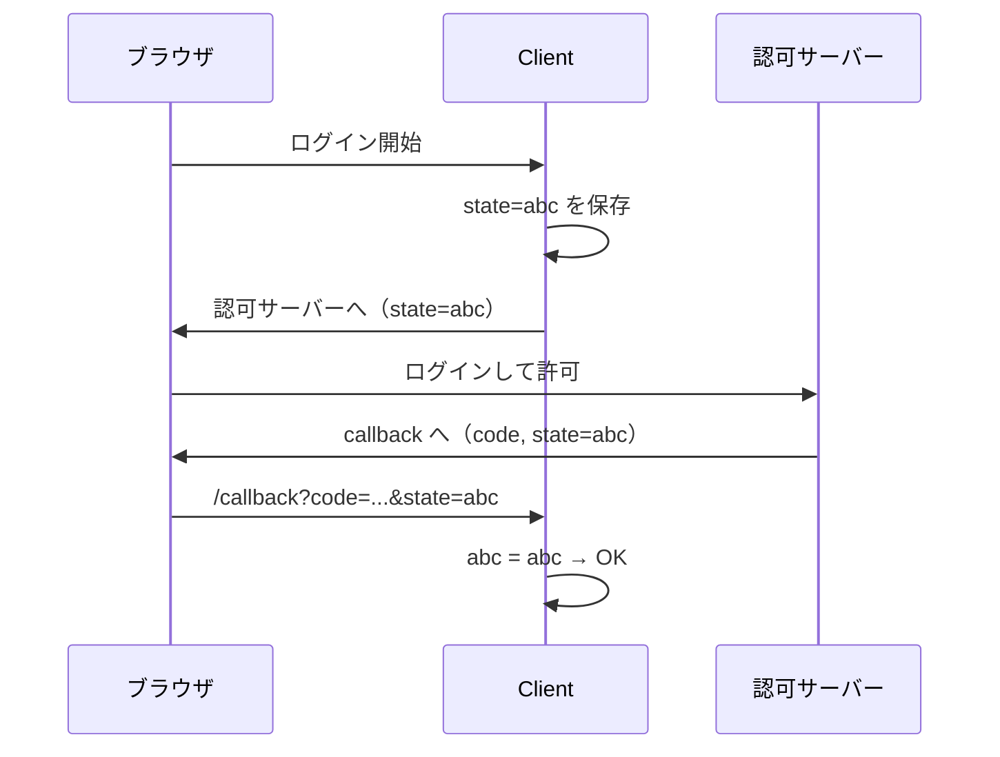
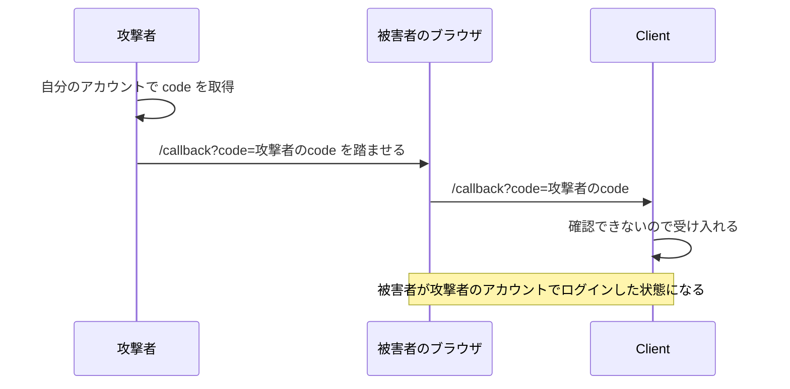
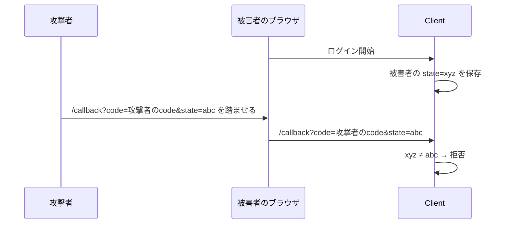

## ⭐️OAuth2.0: Stateの役割について

### 前提

- OAuth 2.0: ユーザーの許可を得て、アプリがユーザーのリソースにアクセスする仕組み（認可）
- OIDC: OAuth 2.0 に「誰がログインしたか」を示す ID トークンを足したもの（認証）

### state の流れ

Client がランダムな state を作ってセッションに保存し、戻ってきた値と比べる。

### state がない場合

攻撃者の code を被害者のブラウザに送り込める（CSRF）。

被害者がアップロードしたファイルやカード情報が、攻撃者のアカウントに入る。

### state がある場合

被害者のセッションの state と一致しないので拒否される。攻撃者は被害者の state を知らない。

補足: PKCE（開始時の秘密値を code 交換時に提示する仕組み）でも同じ攻撃を防げる（RFC 9700 2.1）。

https://datatracker.ietf.org/doc/html/rfc6749#section-10.12
https://datatracker.ietf.org/doc/html/rfc9700#section-2.1
