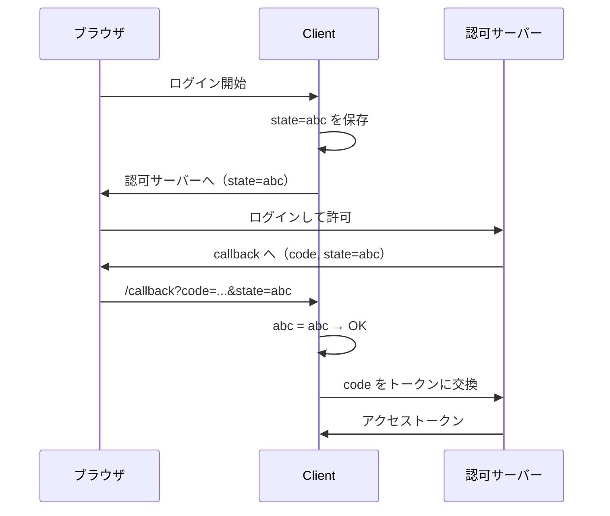
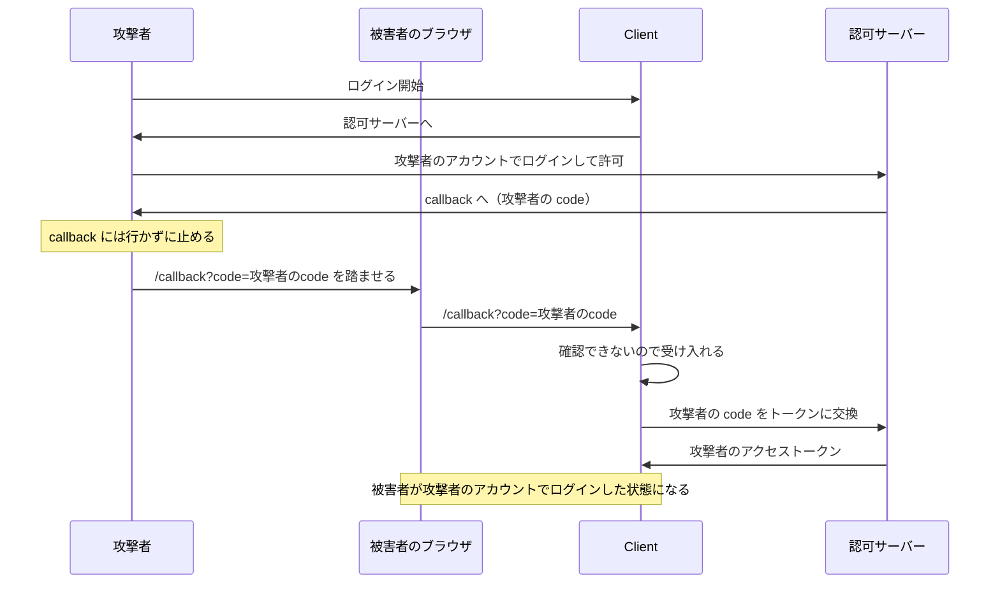
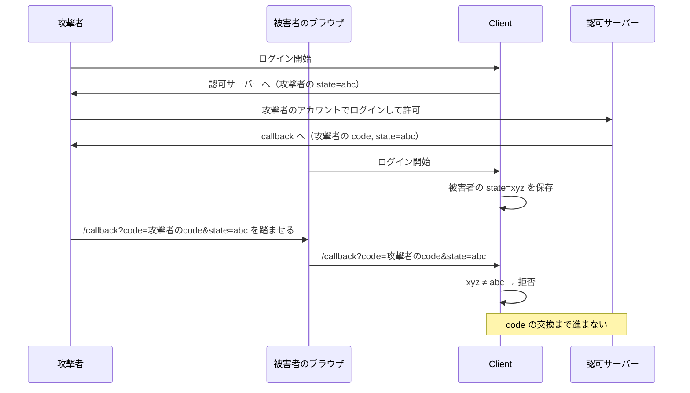

## ⭐️OAuth2.0: Stateの役割について

### 前提

- OAuth 2.0: ユーザーの許可を得て、アプリがユーザーのリソースにアクセスする仕組み（認可）
- OIDC: OAuth 2.0 に「誰がログインしたか」を示す ID トークンを足したもの（認証）

### state の流れ

> An opaque value used by the client to maintain state between the request and callback. ... The parameter SHOULD be used for preventing cross-site request forgery as described in Section 10.12.
> — RFC 6749 4.1.1
>
> 訳: リクエストからコールバックまでの間、状態を保つために Client が使う、中身に意味を持たない値。…… 10.12 節にあるクロスサイトリクエストフォージェリ（CSRF）を防ぐために使うべきである（SHOULD）。

Client がランダムな state を作ってセッションに保存し、戻ってきた値と比べる。

### state がない場合

攻撃者の code を被害者のブラウザに送り込める（CSRF）。

被害者がアップロードしたファイルやカード情報が、攻撃者のアカウントに入る。

### state がある場合

被害者のセッションの state と一致しないので拒否される。攻撃者は被害者の state を知らない。

### state と PKCE の違い

PKCE: 開始時に秘密値を作り、code 交換時に提示する。秘密値を持たない者は code を使えない。

| | state | PKCE |
| --- | --- | --- |
| 主な目的 | CSRF 対策 | code の盗難・注入対策 |
| 確認する人 | Client（callback 時） | 認可サーバー（code 交換時） |
| CSRF | 防げる | 副次的に防げる |

PKCE で CSRF も防げる理由: 攻撃者の code は攻撃者の秘密値に紐づいている。被害者の Client は自分の秘密値で交換しようとするので、認可サーバーが拒否する。

> as a side effect, it prevents CSRF even in the presence of strong attackers
> — RFC 9700 2.1.1
>
> 訳: 副次的な効果として、強力な攻撃者がいる場合でも CSRF を防ぐ。

https://datatracker.ietf.org/doc/html/rfc6749#section-10.12
https://datatracker.ietf.org/doc/html/rfc9700#section-2.1.1
https://datatracker.ietf.org/doc/html/rfc6749#section-4.1.1
